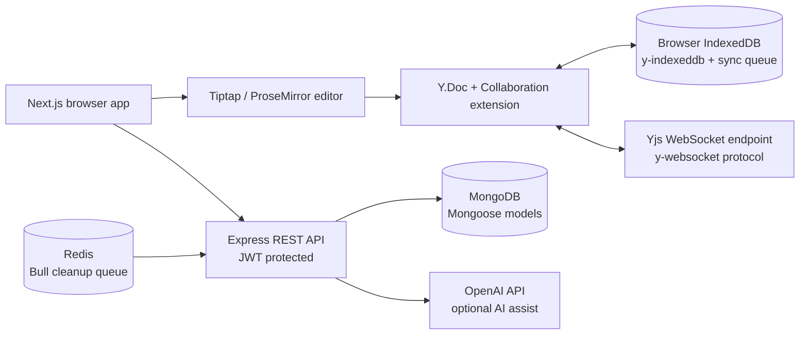
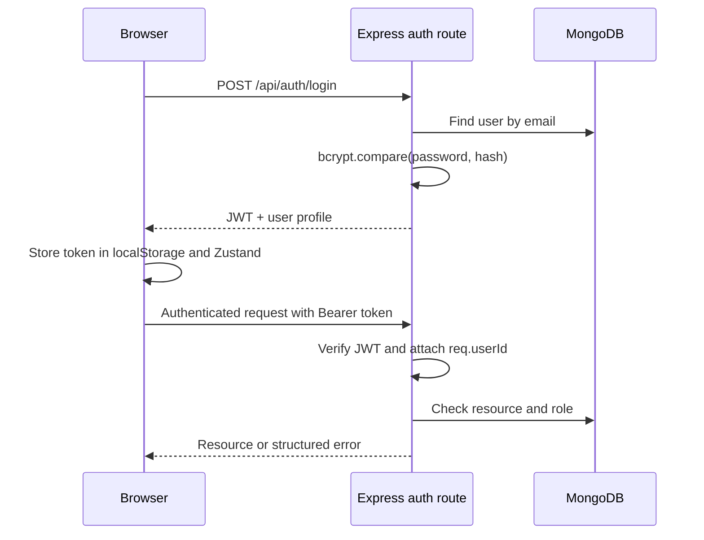
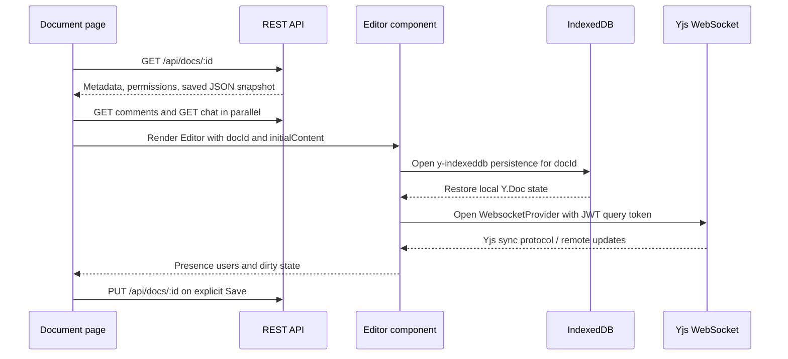
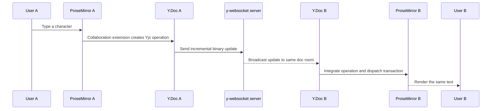

# Synapsribe

Synapsribe is a full-stack collaborative document editor. It combines a rich-text editor, real-time multi-user editing, offline-first local persistence, document permissions, comments, chat, version snapshots, PDF export, and optional AI assistance.

This README is written as both a project guide and an interview preparation document. It explains what is implemented today, why the main technologies were selected, and how to describe the Yjs collaboration model clearly.

## 1. Project summary

### The one-minute explanation

The frontend is a Next.js application that renders a Tiptap/ProseMirror editor. Every open document is represented locally by a Yjs `Y.Doc`. Tiptap binds its ProseMirror document to a Yjs XML fragment, so edits become CRDT operations instead of whole-document replacements.

When the browser is online, `y-websocket` synchronizes that Yjs document with the backend over WebSocket. When it is offline, `y-indexeddb` keeps the document in the browser so the user can continue editing. When connectivity returns, Yjs merges local and remote operations without requiring a manual diff or last-write-wins overwrite.

The Express backend provides JWT authentication, document CRUD, access control, comments, chat, AI assistance, versions, PDF export, and the authenticated Yjs WebSocket endpoint. MongoDB stores users, document metadata, permissions, comments, chat messages, and explicit version snapshots.

### Core product capabilities

- Rich-text editing with Tiptap and ProseMirror.
- Real-time collaborative editing through Yjs and `y-websocket`.
- Live collaborator count, names, colors, cursors, and selections.
- Offline document editing through `y-indexeddb`.
- JWT-based authentication with bcrypt password hashing.
- Document sharing with owner, editor, and viewer roles.
- Comments anchored to ProseMirror ranges.
- Persistent document chat backed by MongoDB.
- Explicit document saves and version snapshots.
- PDF export using a sandboxed Puppeteer page.
- AI rewrite, summarize, and expand assistance through the backend.
- PWA service worker and an IndexedDB queue for selected offline operations.

## 2. Architecture at a glance



### Important transport distinction

The active editor synchronization path is:

```text
Tiptap Collaboration
  -> Y.Doc
  -> y-websocket WebsocketProvider
  -> authenticated ws://localhost:3001/<documentId>
  -> y-websocket server adapter
```

The backend also contains a Socket.IO `/collab` namespace with room, update, and awareness event handlers. That namespace is a separate placeholder/legacy collaboration path and is not the provider used by the current `Editor` component. In an interview, be explicit about this distinction rather than saying that the current editor sends Yjs updates through Socket.IO.

## 3. Repository structure

```text
D:\DOC2.0
├── README.md                         # This architecture and interview guide
├── API_CONTRACTS.md                  # Earlier REST and Socket.IO contract notes
├── .env.example                      # Environment variable starting point
├── frontend/
│   ├── src/app/
│   │   ├── page.tsx                  # Dashboard / document list
│   │   ├── auth/page.tsx             # Login and registration
│   │   ├── documents/[id]/page.tsx   # Collaborative editor workspace
│   │   ├── profile/page.tsx          # User profile and password settings
│   │   └── globals.css               # Global visual system and editor styles
│   ├── src/components/
│   │   ├── Editor.tsx                # Tiptap, Yjs, toolbar, cursors, save flow
│   │   ├── DocumentInspector.tsx     # Outline, activity, collaborators, chat
│   │   ├── Sidebar.tsx               # Navigation and recent documents
│   │   ├── ShareModal.tsx             # Owner sharing UI
│   │   ├── VersionHistory.tsx         # Snapshot history UI
│   │   ├── DrawingCanvas.tsx          # Image/sketch insertion
│   │   └── InteractiveDrawing.tsx     # Drawing node UI
│   ├── src/services/syncService.ts   # IndexedDB + WebSocket orchestration
│   ├── src/store/authStore.ts        # Zustand auth/profile state
│   ├── src/utils/api.ts              # Axios REST client
│   ├── src/utils/syncQueue.ts        # Offline operation queue
│   ├── src/hooks/useSyncManager.ts   # Service-worker sync integration
│   ├── src/types/                    # Shared frontend TypeScript types
│   ├── public/                       # Manifest, service worker, icons
│   └── package.json
├── backend/
│   ├── src/server.ts                 # Express, Mongo, WebSocket, Socket.IO entrypoint
│   ├── src/routes/
│   │   ├── auth.ts                   # Register, login, profile, refresh
│   │   ├── docs.ts                   # Document CRUD, sharing, PDF export
│   │   ├── comments.ts               # Comment threads and replies
│   │   ├── chat.ts                   # Persistent document chat
│   │   ├── versions.ts               # Version snapshots and diffs
│   │   └── ai.ts                     # AI assistance endpoint
│   ├── src/models/                   # Mongoose schemas
│   ├── src/services/
│   │   ├── authService.ts            # JWT and bcrypt helpers
│   │   ├── aiService.ts              # OpenAI HTTP integration
│   │   └── versionCleanup.ts         # Bull/Redis cleanup job
│   ├── src/middleware/auth.ts        # JWT middleware and error response format
│   └── package.json
└── design-*.md / other guides        # Design and implementation notes
```

## 4. Technology choices

| Area | Choice | Why it is used |
|---|---|---|
| Frontend framework | Next.js App Router | Routing, React rendering, production build, and PWA integration |
| UI | React, Tailwind CSS, custom CSS | Component composition plus the product visual system |
| Editor | Tiptap + ProseMirror | Extensible rich-text schema and editor transactions |
| Collaboration | Yjs | Conflict-free replicated data type for concurrent and offline edits |
| Tiptap binding | `@tiptap/extension-collaboration` | Maps ProseMirror transactions to a Yjs XML fragment |
| Cursor binding | `@tiptap/extension-collaboration-cursor` | Renders remote carets, labels, and selections from Awareness |
| WebSocket provider | `y-websocket` | Exchanges Yjs sync and awareness messages |
| Offline document cache | `y-indexeddb` | Persists a Yjs document in the browser |
| Browser state | Zustand | Small global auth/profile store |
| HTTP client | Axios | Authenticated REST requests through one API client |
| Backend | Express + TypeScript | Simple REST API and server composition |
| Database | MongoDB + Mongoose | Flexible document metadata, users, comments, chat, and snapshots |
| Authentication | JWT + bcryptjs | Stateless API authentication and password hashing |
| Background jobs | Bull + Redis | Daily cleanup of old version snapshots |
| Export | Puppeteer | Server-side PDF rendering with request interception |
| PWA | `next-pwa` + service worker | Installability and offline shell/caching support |

## 5. Running the project locally

### Prerequisites

- Node.js 18 or newer.
- MongoDB, local or hosted.
- Redis if the Bull version-cleanup worker is enabled.
- An OpenAI API key only if AI assistance is being exercised.

### Backend environment

Create `backend/.env`:

```env
NODE_ENV=development
PORT=3001
MONGO_URI=mongodb://localhost:27017/synapsribe
JWT_SECRET=replace-with-a-long-random-secret
JWT_EXPIRY=7d
FRONTEND_URL=http://localhost:3000

# Optional AI feature
OPENAI_API_KEY=
OPENAI_MODEL=gpt-4-turbo-preview

# Optional Bull/Redis configuration
REDIS_HOST=localhost
REDIS_PORT=6379
```

### Frontend environment

Create `frontend/.env.local`:

```env
NEXT_PUBLIC_API_URL=http://localhost:3001
NEXT_PUBLIC_WS_URL=ws://localhost:3001
```

`NEXT_PUBLIC_API_URL` is used by the Axios API client. `NEXT_PUBLIC_WS_URL` is used by the Yjs `WebsocketProvider`. The current source falls back to port `3001` when these values are omitted.

### Install and start

```powershell
cd backend
npm install
npm run dev
```

In another terminal:

```powershell
cd frontend
npm install
npm run dev
```

Open:

```text
http://localhost:3000
```

The backend health endpoint is:

```text
http://localhost:3001/health
```

### Useful scripts

Frontend:

```powershell
npm run dev          # Next development server
npm run type-check   # TypeScript validation
npm run build        # Production build
npm run start        # Serve the production build
```

Backend:

```powershell
npm run dev          # ts-node-dev server on port 3001
npm run type-check   # TypeScript validation
npm run build        # Compile TypeScript into dist/
npm run start        # Run dist/server.js
```

## 6. Request and data boundaries

The project deliberately has two kinds of data flow:

1. **Durable application data** uses authenticated REST requests and MongoDB.
2. **Low-latency collaborative editor state** uses Yjs over WebSocket and is represented locally in a Yjs document.

| Data | Transport | Durable storage | Notes |
|---|---|---|---|
| Login, registration, profile | REST | MongoDB | JWT is returned after login/register |
| Document metadata and permissions | REST | MongoDB | Title, owner, role lists, timestamps |
| Live text edits | Yjs WebSocket | Client IndexedDB; explicit JSON save in MongoDB | Binary CRDT updates are not written to MongoDB by the current server adapter |
| Presence and cursor selection | Yjs Awareness | None | Ephemeral; disappears when the client disconnects |
| Comments | REST | MongoDB | Position ranges are stored with the thread |
| Document chat | REST | MongoDB | The UI refreshes chat approximately every four seconds |
| Version snapshots | REST | MongoDB | Explicit snapshots with author, version, and offline metadata |
| AI suggestions | REST to backend, backend to OpenAI | Not stored by default | Returns up to three variants |
| PDF export | REST | Generated response only | Rendered by Puppeteer and returned as a PDF blob |

## 7. Authentication and authorization

### HTTP request flow



The backend middleware expects:

```http
Authorization: Bearer <jwt>
```

`authService.ts` signs a payload containing `userId` and `email`. `authMiddleware` verifies the token and attaches those values to the Express request. Route handlers then perform resource-level checks, because a valid login alone does not imply access to every document.

### Document roles

- **Owner:** owns the document, can edit, share, and create versions.
- **Editor:** can edit and create versions.
- **Viewer:** can read REST-backed content and comments, but the current Yjs WebSocket gate does not open a collaborative editing connection for viewers.

The WebSocket authorization is important. Browsers cannot reliably add a custom `Authorization` header to the standard WebSocket handshake through this provider, so the frontend passes the JWT as a query parameter. The server validates it before calling `setupWSConnection`:

```text
ws://localhost:3001/<documentId>?token=<jwt>
```

The server then loads the document from MongoDB and allows the connection only for an owner or editor. This is an authentication and authorization gate before the client joins the Yjs room.

## 8. Document page lifecycle

The document route is `frontend/src/app/documents/[id]/page.tsx`.



The editor has its own dirty state. Typing changes the local editor and Yjs document immediately. The toolbar Save action serializes the current ProseMirror JSON with `editor.getJSON()` and sends it to `PUT /api/docs/:id`. That explicit JSON snapshot is useful for REST loading, export, and recovery, while Yjs handles the low-latency collaborative session.

## 9. Yjs explained in detail

### 9.1 What problem Yjs solves

If two clients edit the same server-side JSON document using ordinary `PUT` requests, the backend must choose which request wins or implement a custom merge algorithm. That creates race conditions and can overwrite another user's changes.

Yjs avoids treating the document as one replaceable JSON value. It models changes as operations in a CRDT. Each client can create operations independently. When operations arrive in a different order, each replica applies them according to the CRDT rules and converges to the same logical state.

The result is:

- No central lock is required for ordinary text edits.
- Concurrent edits do not depend on network arrival order.
- Offline edits can be merged after reconnecting.
- Updates are incremental instead of sending the entire document for every keystroke.

### 9.2 The objects in this project

#### `Y.Doc`

`Y.Doc` is the shared CRDT document held by one browser tab. In `Editor.tsx`, it is created once for the mounted editor:

```ts
const ydoc = useMemo(() => new Y.Doc(), []);
```

The document contains Yjs shared types. This project uses an XML fragment named `prosemirror`:

```ts
Collaboration.configure({
  fragment: ydoc.getXmlFragment('prosemirror'),
})
```

#### ProseMirror and Tiptap

Tiptap is the React-friendly editor layer built on ProseMirror. ProseMirror has a schema, transactions, selections, and editor state. The collaboration extension binds those transactions to the Yjs XML fragment.

The user types into ProseMirror, ProseMirror creates a transaction, the collaboration extension encodes the change into Yjs, and the provider distributes it to other clients. On the receiving client, the Yjs change is applied to its local shared type and Tiptap renders the updated state.

#### `WebsocketProvider`

`WebsocketProvider` is the network adapter. This project creates it with:

```ts
new WebsocketProvider(
  process.env.NEXT_PUBLIC_WS_URL || 'ws://localhost:3001',
  docId,
  ydoc,
  {
    params: token ? { token } : {},
    awareness,
  }
)
```

The second argument, `docId`, is the Yjs room name. Users editing the same document use the same room name and therefore exchange updates for the same logical document.

#### `Awareness`

Awareness is separate from the durable document content. It carries transient state such as:

```ts
{
  user: {
    name: 'A user',
    color: '#2cc5a4'
  },
  cursor: {
    anchor: 42,
    head: 47
  }
}
```

This project sets the local `user` field and gives the same `Awareness` instance to both the WebSocket provider and Tiptap's collaboration cursor extension. The provider broadcasts awareness changes; it does not write them to MongoDB.

### 9.3 What happens when a user types



The server does not need to understand the paragraph or character-level meaning of the update. It authenticates the connection, associates it with the document room, and relays the Yjs protocol messages. Yjs clients interpret and merge the binary update.

### 9.4 How conflict resolution works

Suppose User A and User B are offline and both insert text near the same position:

```text
Initial:       "Hello"
User A:        "Hello A"   while offline
User B:        "Hello B"   while offline
```

They do not upload two competing full strings. Each client creates CRDT operations with unique identity and ordering metadata. When both update sets are exchanged, Yjs integrates both operations deterministically. The final result contains both edits in a stable order according to the CRDT's internal ordering rules.

That is the key interview phrase:

> Yjs gives each replica an operation-based, causally ordered document state. Updates are commutative and idempotent, so replicas converge even when edits arrive late, duplicated, or out of order.

This is different from:

- **Last write wins:** easy to implement, but silently loses concurrent edits.
- **Operational transformation:** powerful, but requires a central transformation protocol and more coordination.
- **Whole-document diffing:** expensive and fragile for rich-text structure, selections, and embedded nodes.

### 9.5 How cursors and selection marks work

The visible cursor is not stored as part of the document's text. It is ephemeral awareness state:

1. A user's selection changes in ProseMirror.
2. `CollaborationCursor` converts the selection into awareness information.
3. The provider broadcasts it to peers in the same document room.
4. Each peer's `CollaborationCursor` extension reads the remote state.
5. The custom renderer draws a colored caret and a collaborator name label.
6. The selection renderer adds a translucent selection mark.

The project styles these elements in `frontend/src/app/globals.css`:

- `.collaboration-cursor__caret` for the caret border.
- `.collaboration-cursor__label` for the colored name chip.
- `.collaboration-cursor__selection` for the translucent selected range.

Because this data is awareness, a cursor disappears when the user disconnects and is not part of the saved document JSON.

### 9.6 Initialization order

The editor's collaboration setup is intentionally ordered:

1. Create one `Y.Doc` for the mounted editor.
2. Create one `Awareness` instance associated with that document.
3. Set the local user name and color.
4. Create `IndexeddbPersistence` and wait for its `synced` event.
5. Create the `WebsocketProvider` if the browser is online.
6. Configure Tiptap Collaboration with the Yjs XML fragment.
7. Configure CollaborationCursor with the same Awareness instance.
8. Listen for Awareness changes and update the header and inspector collaborator list.

Waiting for IndexedDB first makes the local-first behavior predictable: the editor can restore locally cached state before network synchronization adds remote updates.

### 9.7 Why no manual merge code appears in the React page

The React page owns UI concerns such as loading, dirty state, tabs, chat, and inspector state. It does not manually merge remote editor JSON. That responsibility is delegated to:

- Tiptap/ProseMirror for editor transactions.
- `@tiptap/extension-collaboration` for ProseMirror-to-Yjs binding.
- Yjs for CRDT state and conflict resolution.
- `y-websocket` for network transport.
- `y-indexeddb` for local persistence.

This separation prevents UI code from becoming a second synchronization engine.

## 10. Offline-first behavior

There are two related offline mechanisms.

### Local document editing

`y-indexeddb` stores the Yjs document locally under the document ID. If the browser loses network access:

- The user can continue editing the local document.
- The offline indicator explains that collaboration is paused.
- The WebSocket provider is not used for remote synchronization while offline.
- When the browser comes back online, the sync service can reconnect the provider and Yjs exchanges missing updates.

### REST operation queue

`frontend/src/utils/syncQueue.ts` stores selected application operations in a separate IndexedDB database named `synapsribe-sync-queue`. The queue records:

- Operation type.
- Document ID.
- Payload.
- Timestamp.
- Retry count.
- Last error.

`SyncService.processPendingOperations()` processes operations when connectivity returns. It uses a maximum of five retries and exponential backoff. The queue currently covers document updates, version creation, and comment creation.

The service worker integration in `useSyncManager.ts` listens for a `PROCESS_SYNC_QUEUE` message and starts the queue processor.

### Offline tradeoff to explain in an interview

The current implementation is local-first rather than a fully durable server-side Yjs history service. Browser IndexedDB protects a user's local work, and explicit Save writes a JSON snapshot to MongoDB. A production version should add durable Yjs update persistence or periodic encoded-state snapshots on the server so that a server restart does not depend on a still-connected browser replaying its state.

## 11. Persistence and versioning

### MongoDB models

#### `User`

Stores email, bcrypt password hash, display name, and timestamps.

#### `Document`

Stores:

- `title`
- `ownerId`
- `content` as a flexible JSON snapshot
- `currentVersion`
- `lastSyncedAt`
- metadata such as tags and drawing data
- editor and viewer permission arrays
- timestamps

#### `Comment`

Stores a document ID, author, text, ProseMirror range, resolved state, and replies.

#### `ChatMessage`

Stores a document ID, author, message text, and timestamps. Messages are indexed by document and creation time, limited to the most recent 200 in the current API response.

#### `DocumentVersion`

Stores a snapshot with document ID, monotonically increasing version number, JSON content, change description, author, offline flag, optional device ID, and creation time. A unique compound index prevents duplicate version numbers for the same document.

### Explicit save flow

```text
Editor.getJSON()
  -> page handleSaveDoc(content)
  -> PUT /api/docs/:docId
  -> Document.content in MongoDB
```

The version API uses an atomic MongoDB update to advance `currentVersion`. It also checks the latest stored version first, which protects the counter when older data has a stale document counter.

## 12. REST API map

All routes below are mounted by `backend/src/server.ts`. Protected routes require a Bearer JWT.

### Authentication

| Method | Route | Purpose |
|---|---|---|
| POST | `/api/auth/register` | Create a user, hash the password, return JWT |
| POST | `/api/auth/login` | Verify credentials and return JWT |
| POST | `/api/auth/refresh` | Issue a new JWT from an authenticated request |
| GET | `/api/auth/me` | Return the current profile |
| PUT | `/api/auth/me` | Update name and/or password |

### Documents and sharing

| Method | Route | Purpose |
|---|---|---|
| GET | `/api/docs` | List documents accessible to the user |
| POST | `/api/docs` | Create a document owned by the current user |
| GET | `/api/docs/:docId` | Read metadata, permissions, and saved snapshot |
| PUT | `/api/docs/:docId` | Update title, metadata, or saved content |
| DELETE | `/api/docs/:docId` | Delete a document when authorized |
| POST | `/api/docs/:docId/share` | Add an editor or viewer by email |
| POST | `/api/docs/:docId/export/pdf` | Generate a PDF from supplied HTML/CSS |

### Comments and chat

| Method | Route | Purpose |
|---|---|---|
| GET | `/api/comments/:docId` | List comment threads |
| POST | `/api/comments/:docId` | Create a range-anchored comment |
| PATCH | `/api/comments/:commentId` | Resolve a comment or add a reply |
| GET | `/api/chat/:docId` | Load persisted chat messages |
| POST | `/api/chat/:docId` | Add a chat message after access validation |

### AI and versions

| Method | Route | Purpose |
|---|---|---|
| POST | `/api/ai/assist` | Rewrite, summarize, or expand selected text |
| POST | `/api/versions/:docId` | Create a version snapshot |
| GET | `/api/versions/:docId` | Paginated version list |
| GET | `/api/versions/:docId/:versionId` | Read a full version snapshot |
| GET | `/api/versions/:docId/:versionId/diff/:compareVersionId` | Return two snapshot payloads for comparison |

## 13. WebSocket and room security

The `WebSocketServer` is attached to the same HTTP server as Express. On a new WebSocket connection, the backend:

1. Reads the JWT from the `Authorization` header or `token` query parameter.
2. Verifies the JWT with the same `authService` used by HTTP routes.
3. Extracts the document ID from the WebSocket pathname.
4. Loads the document from MongoDB.
5. Checks the user is the owner or an editor.
6. Closes the connection with code `1008` when authentication or authorization fails.
7. Calls `setupWSConnection` only after those checks pass.

This ordering matters. A WebSocket room name is not an authorization mechanism by itself; the server must authorize the user before allowing a connection to exchange Yjs updates.

### Scaling considerations

The current `y-websocket` server is suitable for a single backend instance and a local/small deployment. For horizontal scaling, I would add:

- Durable Yjs update storage or periodic encoded state snapshots.
- A shared pub/sub or provider layer so clients in different backend instances see the same room updates.
- Connection and room metrics.
- Rate limiting and maximum update sizes.
- Token expiry/re-authentication handling for long-lived WebSocket connections.
- A clear read-only synchronization strategy for viewers.
- Backpressure and connection limits.

Redis is already present for Bull version cleanup, but using Redis for the cleanup queue is not the same as using it as a Yjs WebSocket fan-out layer.

## 14. Chat, comments, and activity UI

### Chat

Chat intentionally does not use Yjs because chat messages are an append-only application stream rather than part of the document's collaborative text state.

The current flow is:

```text
Chat composer
  -> POST /api/chat/:docId
  -> ChatMessage MongoDB document
  -> GET /api/chat/:docId
  -> DocumentInspector chat list
```

The document page refreshes chat approximately every four seconds, which gives cross-tab updates without coupling chat persistence to the editor CRDT. A future version could replace polling with a dedicated Socket.IO event or Server-Sent Events channel.

### Comments

Comments are stored independently from the Yjs document. A comment records ProseMirror `start` and `end` positions, author, text, replies, and resolved state. That keeps comment permissions and lifecycle in the application database, although production implementations should consider more durable anchors such as relative Yjs positions when text moves frequently.

### Activity and presence

The inspector's activity view is based on current Awareness state. Presence is not an activity audit log. A true audit log would require persisted events such as user ID, operation type, timestamp, and document version.

## 15. AI assistance and PDF export

### AI assistance

The frontend calls `POST /api/ai/assist` with selected text and one of:

- `rewrite`
- `summarize`
- `expand`

The backend validates the action, builds a prompt, calls the configured OpenAI endpoint, and returns up to three variants plus token usage. The API key stays on the backend and is never sent to the browser.

### PDF export

The frontend sends HTML and optional CSS to the document export endpoint. The backend creates a Puppeteer page with:

- JavaScript disabled.
- Request interception enabled.
- Only `about:`, `data:`, and `blob:` resources allowed.
- External requests aborted.
- Inline CSS and HTML sanitized for the export context.

The server returns an `application/pdf` response. In a production deployment, Chromium resource limits, timeouts, and job isolation should be monitored carefully.

## 16. Common interview questions and strong answers

### “Explain the project in 30 seconds.”

> Synapsribe is a Next.js collaborative editor. Tiptap provides the ProseMirror rich-text experience, and Yjs represents each document as a CRDT so multiple users and offline clients can make edits without last-write-wins data loss. A y-websocket provider exchanges incremental Yjs updates with an authenticated Express backend, while y-indexeddb gives each browser local persistence. MongoDB handles application data such as users, permissions, comments, chat, and explicit document snapshots. JWT protects REST and WebSocket access.

### “Why did you choose Yjs?”

> The central requirement is concurrent editing with intermittent connectivity. Yjs provides an operation-based CRDT that merges independent edits deterministically and idempotently. That means the application does not need to compare and replace whole JSON documents on every keystroke, and offline edits can be merged after reconnecting.

### “What is the difference between Yjs and ProseMirror?”

> ProseMirror owns the editor schema, transactions, selections, and rendering. Yjs owns the replicated shared state. Tiptap's collaboration extension is the adapter between them: it translates ProseMirror transactions into Yjs operations and applies incoming Yjs operations back to the editor.

### “How does a remote cursor appear?”

> Cursor and selection data is sent through Yjs Awareness, not stored in the document content. The CollaborationCursor extension observes Awareness, then renders a colored caret, name label, and translucent selection range. It is ephemeral and disappears when the client leaves.

### “How are conflicts resolved?”

> Each client creates CRDT operations with unique client identity and causality metadata. Yjs integrates operations based on its CRDT rules, so updates are idempotent and replicas converge even if messages arrive out of order. This avoids silently discarding one user's edit like a last-write-wins database update would.

### “What happens if the user goes offline?”

> The Yjs document remains usable locally and `y-indexeddb` persists it in the browser. The WebSocket provider is unavailable while offline, but local editing continues. When the network returns, the provider reconnects and Yjs exchanges missing operations. Selected REST operations also go into an IndexedDB retry queue.

### “Is every Yjs operation stored in MongoDB?”

> Not in the current implementation. The live session is handled by the y-websocket server, and the browser has y-indexeddb persistence. The explicit Save action serializes the editor to JSON and stores that snapshot in the Document model. For production durability after a server restart, I would add a durable Yjs update log or encoded-state snapshot persistence on the server.

### “Why not use Socket.IO for the editor?”

> The current editor uses the protocol and provider built for Yjs: `y-websocket`. Socket.IO is useful for application events and there is a separate `/collab` namespace in this repository, but it is not the active Tiptap/Yjs transport. If I standardized the system, I would either remove the unused path or clearly separate it for application events such as notifications and chat.

### “How is a WebSocket authorized?”

> The browser passes the JWT as a WebSocket query parameter because it cannot set a normal Authorization header in this provider's handshake. The backend verifies the token, loads the document, checks owner/editor permissions, and only then calls `setupWSConnection`. Viewers are rejected from the collaborative editing connection.

### “How would you scale this?”

> I would first make Yjs state durable, then add a shared room/fan-out mechanism for multiple WebSocket instances, such as a supported Redis/pub-sub provider. I would add connection metrics, room membership metrics, update size limits, rate limits, and a strategy for reconnecting expired tokens. MongoDB would remain the system of record for application entities, not necessarily the per-keystroke update transport.

### “How would you improve comments?”

> Current comments store numeric ProseMirror ranges, which is simple but can become fragile when text moves. I would store Yjs-relative positions or another stable anchor so a comment follows the referenced text through concurrent edits, then resolve it against the current document when rendering.

### “How do you test collaboration?”

> I would open two authenticated browser contexts on the same document, type concurrently, verify both converge to the same JSON, disconnect one context, edit offline, reconnect it, and verify the merged result. I would also test viewer rejection at the WebSocket handshake, expired JWT handling, Awareness cleanup, duplicate updates, and server restart recovery.

## 17. Testing and verification checklist

### Static checks

```powershell
cd frontend
npm run type-check
npm run build

cd ..\backend
npm run type-check
npm run build
```

### Manual collaboration checks

1. Register or log in with two users.
2. Open the same document in two browser contexts.
3. Confirm the header count and inspector collaborator list update.
4. Place the caret in each editor and confirm the other user's colored caret and name label appear.
5. Select text in one editor and confirm the other editor shows the colored selection mark.
6. Type in both editors and confirm the text converges.
7. Disconnect one browser, edit, reconnect, and confirm the local edits remain.
8. Send chat from one context and confirm it appears in the other context.
9. Test a viewer account and confirm the Yjs WebSocket connection is rejected.
10. Save explicitly and reload to confirm the MongoDB JSON snapshot is available.

### Runtime checks

```powershell
Invoke-WebRequest http://localhost:3001/health
```

Expected response shape:

```json
{
  "status": "ok",
  "timestamp": "..."
}
```

## 18. Production hardening roadmap

The current project is a strong functional prototype, but I would call out these next steps in an interview:

- Replace localStorage JWT storage with secure, httpOnly cookies where appropriate.
- Add CSRF protection if cookie authentication is introduced.
- Add request validation schemas, rate limits, and structured logging.
- Persist Yjs updates or encoded document state server-side.
- Remove or formalize the unused Socket.IO collaboration path.
- Replace chat polling with a real-time event stream.
- Use stable Yjs-relative comment anchors.
- Add automated two-client CRDT convergence tests.
- Add observability for WebSocket connections, room size, sync latency, and update failures.
- Add document-level encryption or stronger tenant isolation if required.
- Configure Redis explicitly for production Bull workers.
- Add file/object storage for uploaded images and drawings instead of large inline payloads.
- Move AI calls to a queue for long-running requests and enforce user-level quotas.
- Add a durable refresh-token strategy and token rotation.
- Add database migrations/index checks and backup/restore runbooks.

## 19. Files to mention during an interview

If asked to navigate the implementation, these are the highest-value files:

- `frontend/src/components/Editor.tsx` — Tiptap editor, Y.Doc, Awareness, provider, cursor rendering, save.
- `frontend/src/services/syncService.ts` — IndexedDB restoration, WebSocket creation, reconnect and offline queue processing.
- `frontend/src/app/documents/[id]/page.tsx` — document lifecycle, comments, chat, presence count, editor composition.
- `backend/src/server.ts` — Express setup, JWT WebSocket gate, y-websocket server, Socket.IO namespace, Mongo connection.
- `backend/src/middleware/auth.ts` — JWT validation for HTTP requests.
- `backend/src/services/authService.ts` — bcrypt and JWT implementation.
- `backend/src/models/Document.ts` — ownership, saved snapshot, metadata, editor/viewer permissions.
- `backend/src/routes/chat.ts` — persistent chat and document access checks.
- `backend/src/routes/versions.ts` — version authorization and atomic version counter.
- `frontend/src/utils/syncQueue.ts` — IndexedDB offline operation queue and retries.

## 20. Final interview framing

The strongest way to present this project is to separate concerns:

```text
Editor UX       = Tiptap / ProseMirror
Shared state    = Yjs CRDT
Transport       = y-websocket
Presence        = Yjs Awareness
Offline cache   = y-indexeddb
Application API = Express REST + JWT
Durable data    = MongoDB
Background work = Bull + Redis
```

The key architectural decision is that the editor does not treat a collaborative document as a mutable JSON blob owned by one request. It treats the document as a replicated Yjs state, while the backend REST API remains responsible for identity, permissions, metadata, comments, chat, versions, and explicit snapshots.
